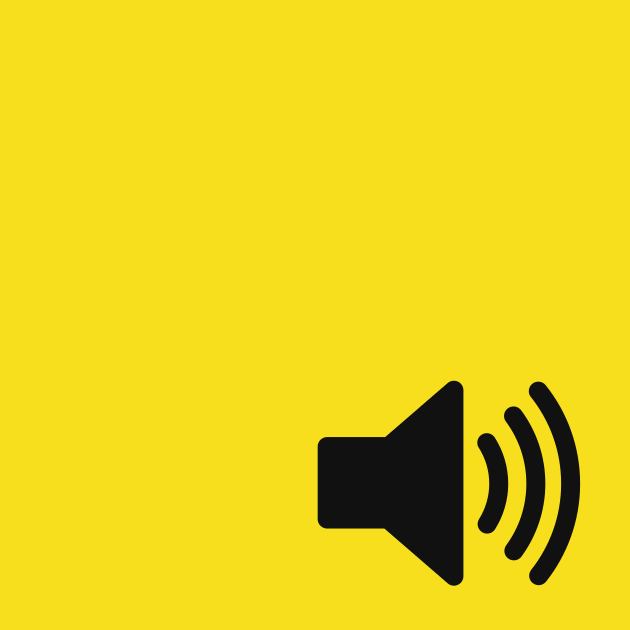

# Web Audio API 1.1 Spec

This repository contains the latest editor's draft of the [W3C AudioWG](https://www.w3.org/groups/wg/audio/)'s Web Audio API v1.1.

You can preview the current version of the `main` branch [here](https://webaudio.github.io/web-audio-api/).

# Tests

For normative changes, a corresponding
[web-platform-tests](https://github.com/web-platform-tests/wpt) PR is highly appreciated. Typically,
both PRs will be merged at the same time. Note that a test change that contradicts the spec should
not be merged before the corresponding spec change. If testing is not practical, please explain why
and if appropriate [file an issue](https://github.com/web-platform-tests/wpt/issues/new) to follow
up later. Add the `type:untestable` or `type:missing-coverage` label as appropriate.

Cross-browser test results are available on [wpt.fyi](https://wpt.fyi/results/webaudio).
